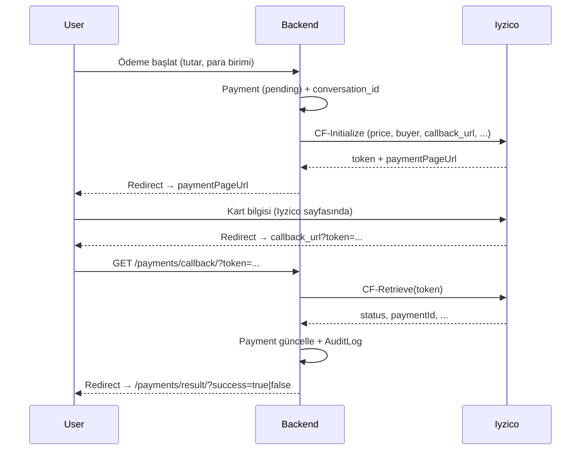

# apps/payments — Iyzico Checkout Form

Bu uygulama yalnızca **Iyzico Checkout Form (CF)** akışını yönetir. Ödeme mantığı tek yerde toplanır; auth, RBAC ve audit’ten bağımsızdır.

## Iyzico Checkout Form

- Resmi dokümantasyon: [Checkout Form](https://docs.iyzico.com/en/payment-methods/checkoutform)
- Kart bilgisi sizin sunucunuza hiç gelmez (PCI-DSS yükü sizde olmaz); kullanıcı Iyzico sayfasında öder.

## Akış (Initialize → Callback → Retrieve)

### 1. Initialize (CF-Initialize)

- **Sorumluluk:** Fiyat, para birimi, alıcı, adres, sepet kalemleri ve **callback URL** ile Iyzico’ya istek atılır.
- Iyzico cevabında `token` ve `paymentPageUrl` gelir; kullanıcı bu URL’e yönlendirilir.
- **conversation_id:** Her istek için benzersiz (UUID). Aynı isteğin iki kez işlenmesini engellemek (idempotency) ve Iyzico tarafında eşleştirme için kullanılır.

### 2. Callback (redirect)

- Ödeme sonrası Iyzico, kullanıcıyı sizin `callback_url`’e yönlendirir; istekte **token** (query veya form) bulunur.
- Backend’de **sadece** bu token kullanılır; gelen diğer parametrelere (örn. “success”) göre karar verilmez.

### 3. Retrieve (CF-Retrieve)

- Callback’te alınan `token` ile Iyzico’ya “bu ödemenin sonucu ne?” sorusu gönderilir.
- Cevaptaki `status` (success/failure), `paymentId`, tutar vb. **güvenilir** bilgidir. Nihai karar yalnızca bu cevaba göre verilir.
- Bu sonuca göre `Payment` kaydı güncellenir, `AuditLog` yazılır, kullanıcı sonuç sayfasına yönlendirilir.

## conversation_id ve Idempotency

- Her initialize isteğinde yeni bir UUID üretilir ve hem `Payment.conversation_id` hem Iyzico isteğinde kullanılır.
- `Payment` modelinde `conversation_id` unique’tir; aynı conversation_id ile ikinci kayıt açılamaz.
- İsteğin ağ/retry nedeniyle tekrar gelmesi durumunda aynı conversation_id ile “zaten işlendi” benzeri bir kontrol eklenebilir.

## Test kartları (Sandbox)

- Sandbox ortamında test kartları kullanılır.
- Resmi liste: [iyzipay-python README – Mock test cards](https://github.com/iyzico/iyzipay-python#mock-test-cards) veya Iyzico sandbox dokümantasyonu.

Örnek (sandbox):  
Kart No: `5528790000000008` (Halkbank Master Card Credit) — başarılı ödeme testi için kullanılabilir.

## Junior’lar için notlar

- **Hata durumları:** Ağ hatası, Iyzico hata kodu (örn. `errorCode`, `errorMessage`) initialize veya retrieve cevabında dönebilir. Bu cevapları loglayın ve gerekirse kullanıcıya anlamlı mesaj gösterin.
- **Loglama ve audit:** Her initialize ve callback/retrieve sonrası `AuditLog` ile `PAYMENT_INITIALIZE` ve `PAYMENT_CALLBACK` yazılır. Metadata’da yalnızca PII olmayan alanlar (payment_id, status, conversation_id) tutulur. Denetim ve hata takibi için önemlidir.
- **Güvenlik:** Callback’te sonucu yalnızca Retrieve cevabına göre kabul edin; URL’deki parametrelere güvenmeyin.
